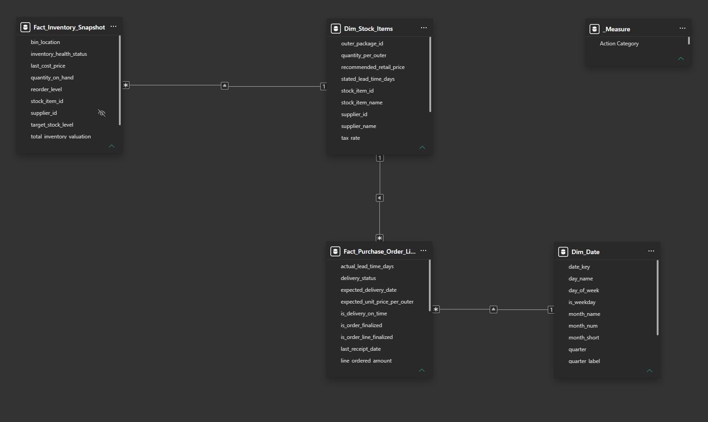
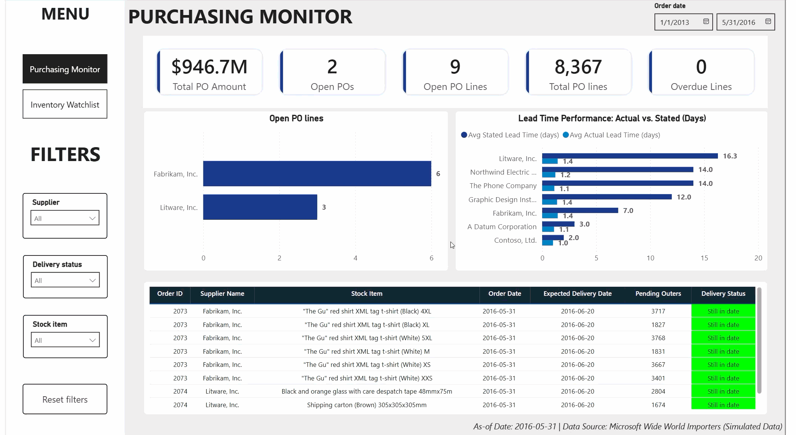
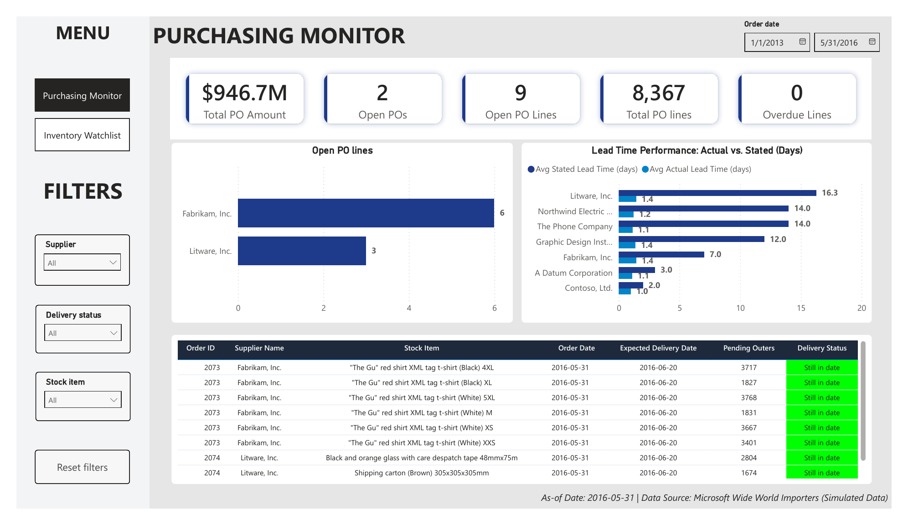
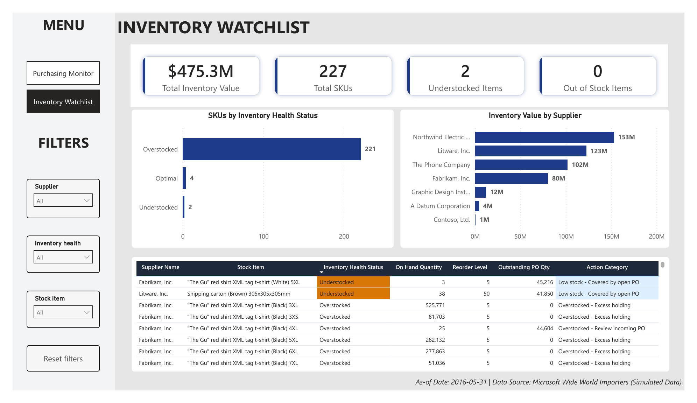

# Purchasing & Inventory Monitoring

I built this project to explore how SQL and Power BI can help a purchasing team track open orders and review stock levels. It uses the simulated **Wide World Importers (WWI)** dataset and covers **8,367 purchase order lines** and **227 stock items (SKUs)**.

The project includes four PostgreSQL views, SQL checks, and a two-page Power BI report. I used an existing PostgreSQL port of WWI, restored it to Supabase, and built the reporting layer from there.

**Reporting date: 2016-05-31.** This is a fixed assumption for the sample. The findings describe this dataset and have not been measured in a live business.

## 1. Business questions

The report focuses on four questions a purchasing team might ask:

| Question | Where to look |
|---|---|
| Which purchase orders and lines are still open? | Purchasing Monitor: KPI cards and open-line table |
| Which open lines are past their expected delivery date? | Purchasing Monitor: Overdue Lines and Delivery Status |
| Which items are at or below their reorder level? | Inventory Watchlist: stock status and item table |
| Do incoming orders cover the quantity shortfall for low-stock items? | Inventory Watchlist: Outstanding PO Qty and Action Category |

## 2. Main findings

These are the results with report filters reset.

| Metric | Result | What it measures |
|---|---:|---|
| Historical PO value | **$946,715,166.50** | Ordered value across all historical PO lines, from 2013 to May 2016 |
| Open purchase orders | **2 POs / 9 lines** | Both the order header and line are unfinished |
| Pending inbound quantity | **25,949 outers / 360,278 base units** | Remaining quantities on open lines, with negative balances capped at zero per line |
| Overdue open lines | **0** | Expected delivery is before the reporting date |
| Inventory value | **$475,279,296.35** | Quantity on hand multiplied by last cost price |
| Stock items | **227 SKUs** | Items in the inventory snapshot |
| Understocked items | **2** | `0 < quantity_on_hand <= reorder_level` |
| Overstocked items | **221** | `quantity_on_hand > target_stock_level` |

### Most items are above their target stock level

**221 of 227 SKUs (97.3%)** are above target. Northwind Electric Cars and Litware hold about **$276M**, or **58%** of total inventory value.

This helps identify where inventory value is concentrated. Sales or stock-issue history would be needed to determine which items are moving slowly.

### The two low-stock items have incoming orders, but delivery is 20 days away

| Item | On hand | Reorder level | Incoming base units |
|---|---:|---:|---:|
| The Gu t-shirt, White 5XL | 3 | 5 | 45,216 |
| Shipping carton, Brown 305x305x305mm | 38 | 50 | 41,850 |

Both incoming quantities cover the shortfall to the reorder level. Their expected delivery date is **2016-06-20**, which is **20 days after the reporting date**. Whether the remaining stock will last until then depends on demand, which this report does not estimate.

### Recorded receipt times are shorter than the catalog lead times

For completed Litware PO lines, the average stated item lead time is **16.3 days**, while the average recorded receipt interval is **1.4 days**. The gap is **actual minus stated**, or about **-14.9 days**.

A negative gap means receipt was faster than the catalog reference. The comparison uses the item's stated lead time; delivery timeliness is assessed separately against the PO's `expected_delivery_date`.

## 3. Data model

I created four views in the `analytics` schema and used them to build the Power BI model.



| View | What one row represents | Key used in the model |
|---|---|---|
| `vw_dim_date` | One calendar date, covering 2013-2016 | `date_key` |
| `vw_dim_stock_items` | One SKU, with supplier and packaging details | `stock_item_id` |
| `vw_fact_purchase_order_lines` | One purchase order line | `purchase_order_line_id`; links through `stock_item_id` and `order_date` |
| `vw_fact_inventory_snapshot` | One SKU's current holding | `stock_item_id` |

These are reporting views over the source tables. The keys listed above are the identifiers used for modeling.

- Relationships filter from dimensions to facts in one direction.
- Both fact tables connect to `Dim_Stock_Items`.
- `Dim_Date` connects to the purchasing fact through `order_date`.
- Inventory stays separate from the date dimension because holdings are a single snapshot. Changing the order-date filter does not reconstruct earlier inventory balances.
- A disconnected `_Measure` table keeps the DAX measures together.

## 4. Dashboard

### Dashboard demo



[Open or download the Power BI report](purchasing-inventory-monitoring.pbix)

### Purchasing Monitor



This page shows the historical value of purchase orders alongside the current open-order backlog.

- KPI cards show historical PO value, total lines, open orders, open lines, and overdue lines.
- The supplier chart shows the open-line workload: **Fabrikam has 6 lines and Litware has 3**.
- The lead-time chart compares actual receipt intervals with stated item lead times for completed lines.
- The detail table lists open PO lines, pending outers, expected delivery dates, and delivery status.

### Inventory Watchlist



This page brings stock levels and incoming orders together for review.

- KPI cards show inventory value, SKU count, understocked items, and out-of-stock items.
- The stock-status chart shows **221 overstocked, 4 optimal, and 2 understocked SKUs**.
- The supplier chart shows how inventory value is distributed.
- The item table compares on-hand quantities, reorder levels, incoming quantities, and action categories.

### Action Category logic

The category is calculated for each item using on-hand stock, reorder level, target stock, and outstanding PO quantity.

| Category | Rule |
|---|---|
| Out of stock | On-hand quantity is zero or negative |
| Low stock - NO open PO | Positive stock is at or below reorder level, with no outstanding inbound quantity |
| Low stock - Open PO insufficient | Stock is at or below reorder level, and on-hand plus incoming quantity is still below it |
| Low stock - Covered by open PO | Stock is at or below reorder level, and on-hand plus incoming quantity reaches that level |
| Overstocked - Review incoming PO | Stock is above target and more units are on order |
| Overstocked - Excess holding | Stock is above target, with no outstanding inbound quantity |
| Within target | Stock is above reorder level and at or below target |

For example, the Black 4XL t-shirt has **25 units on hand against a target of 20**, with another **44,604 units on order**. The report flags it for purchasing review. A decision to change that order would also need demand information.

<details>
<summary>View the Action Category DAX measure</summary>

```dax
Action Category =
VAR OnHand = SUM(Fact_Inventory_Snapshot[quantity_on_hand])
VAR ReorderLvl = SUM(Fact_Inventory_Snapshot[reorder_level])
VAR TargetStock = SUM(Fact_Inventory_Snapshot[target_stock_level])
VAR Incoming = COALESCE([Outstanding PO Qty], 0)
RETURN
IF(
    ISINSCOPE(Dim_Stock_Items[stock_item_name]),
    SWITCH(
        TRUE(),
        ISBLANK(OnHand), BLANK(),
        OnHand <= 0, "Out of stock",
        OnHand <= ReorderLvl && Incoming = 0, "Low stock - NO open PO",
        OnHand <= ReorderLvl && OnHand + Incoming < ReorderLvl, "Low stock - Open PO insufficient",
        OnHand <= ReorderLvl, "Low stock - Covered by open PO",
        OnHand > TargetStock && Incoming > 0, "Overstocked - Review incoming PO",
        OnHand > TargetStock, "Overstocked - Excess holding",
        "Within target"
    ),
    BLANK()
)
```

</details>

## 5. Validation

I compared the source-table totals with the analytics views and checked the Power BI results separately. **All nine checked KPI results matched**, and **all four SQL integrity checks returned zero violations**.

### KPI comparison

The Power BI column records the values checked in the report model. Monetary amounts are compared to two decimal places; counts and quantities are compared as whole numbers.

| Metric | Source tables | Analytics views | Power BI reference |
|---|---:|---:|---:|
| Historical PO value | $946,715,166.50 | $946,715,166.50 | $946,715,166.50 |
| Historical PO lines | 8,367 | 8,367 | 8,367 |
| Open POs | 2 | 2 | 2 |
| Open PO lines | 9 | 9 | 9 |
| Pending outers | 25,949 | 25,949 | 25,949 |
| Overdue open lines | 0 | 0 | 0 |
| Inventory value | $475,279,296.35 | $475,279,296.35 | $475,279,296.35 |
| Inventory SKUs | 227 | 227 | 227 |
| Understocked SKUs | 2 | 2 | 2 |

In `03_data_reconciliation.sql`, `power_bi_benchmark` contains recorded reference values. The script queries PostgreSQL; it does not read or refresh a live Power BI model. Displayed card values such as `$946.7M` are rounded for readability.

### SQL integrity checks

| Check | Violations | Result |
|---|---:|---|
| Closed order header with an open line | 0 | PASS |
| Raw PO line referencing a missing stock item | 0 | PASS |
| Order date missing from `Dim_Date` | 0 | PASS |
| Open line with received quantity above ordered quantity | 0 | PASS |

These checks run in SQL. The date check verifies coverage of the order dates present in the purchasing fact.

## 6. Files

| File | Contents |
|---|---|
| [01_eda_and_data_profiling.sql](01_eda_and_data_profiling.sql) | Source row counts, date ranges, stock levels, receipt quantities, and OTD profiling |
| [02_create_analytics_views.sql](02_create_analytics_views.sql) | The four reporting views in `analytics` |
| [03_data_reconciliation.sql](03_data_reconciliation.sql) | KPI comparisons, integrity checks, and ABC inventory analysis |
| [04_business_queries_and_insights.sql](04_business_queries_and_insights.sql) | Item action categories and low-stock detail |
| [purchasing-inventory-monitoring.pbix](purchasing-inventory-monitoring.pbix) | Power BI model, measures, and two report pages |
| [supply_chain_theme.json](supply_chain_theme.json) | Report colors and fonts |
| [data-model.png](data-model.png) | Model screenshot |
| [purchasing-monitor.png](purchasing-monitor.png) / [inventory-watchlist.png](inventory-watchlist.png) | Report screenshots |
| [dashboard-demo.gif](dashboard-demo.gif) | Report interaction demo |
| [.gitignore](.gitignore) | Exclusions for local credentials, backups, and temporary files |

## 7. Run the project

### Source data and project scope

The PostgreSQL archive is available in the [Azure/azure-postgresql sample repository](https://github.com/Azure/azure-postgresql/tree/master/samples/databases/wide-world-importers). The source README credits the PostgreSQL port to Greg Low.

[Download wide_world_importers_pg.dump](https://raw.githubusercontent.com/Azure/azure-postgresql/master/samples/databases/wide-world-importers/wide_world_importers_pg.dump)

The archive used here is **17,715,137 bytes**. Its SHA256 is:

```text
F2CB95C02BFBA871384669ED27FC694D4CC3091A72E1C21E1A2598BDBE471F8F
```

My work covers restoring the existing archive, profiling the source data, creating the reporting views, writing the analysis and checks, and building the Power BI report.

### Tools used

- PostgreSQL, hosted on Supabase, with DBeaver as the SQL client.
- The report was checked with **Power BI Desktop 2.155.756.0**.

### Restore the sample

Download the archive above and restore it into an empty database. The example below uses the PostgreSQL command-line tools. Replace `<database_user>` with your database username:

```bash
createdb -h localhost -p 5432 -U <database_user> purchasing_inventory

psql -h localhost -p 5432 -U <database_user> -d purchasing_inventory -c "CREATE SCHEMA application; CREATE SCHEMA purchasing; CREATE SCHEMA sales; CREATE SCHEMA sequences; CREATE SCHEMA warehouse;"

pg_restore -h localhost -p 5432 -U <database_user> -d purchasing_inventory \
  --no-owner --no-privileges --single-transaction \
  --schema=application --schema=purchasing --schema=sales \
  --schema=sequences --schema=warehouse \
  wide_world_importers_pg.dump
```

Create the five schemas before restoring this older archive. The schema selection then restores the sample tables and their dependencies without the archive's Azure-specific public objects, extension definitions, owners, or grants.

For a hosted database, use its host, port, username, and database name. A separate Supabase project provides an existing `postgres` database, so the `createdb` step can be skipped there. Keep passwords in the database client's credential settings.

### Run the SQL files

Run the four scripts in order:

1. `01_eda_and_data_profiling.sql` to inspect the source.
2. `02_create_analytics_views.sql` to create the reporting views.
3. `03_data_reconciliation.sql` to compare the KPIs and review the checks.
4. `04_business_queries_and_insights.sql` to inspect the stock actions.

Compare the results with the validation tables in Section 5.

### Open Power BI

1. Open `purchasing-inventory-monitoring.pbix`.
2. Go to **Transform data > Data source settings** and set the PostgreSQL connection to your database.
3. Refresh the report and reset its filters.
4. Compare the KPI cards with Section 5.

The PBIX includes an imported data snapshot for review. Refreshing it requires access to a restored copy of the source database and the `analytics` views.

## 8. Limitations

- **Simulated data:** The stock levels and delivery patterns come from a sample database. They provide examples for analysis, not evidence of business outcomes.
- **One inventory snapshot:** Holdings do not provide a daily inventory history. This project does not calculate inventory turnover, stockout duration, or historical carrying costs.
- **Fixed reporting date:** The report uses 2016-05-31. Current status flags do not reconstruct the backlog at arbitrary earlier dates.
- **Receipt-date meaning:** `last_receipt_date` records the last receipt on a line. It does not show every partial receipt or confirm a final acceptance date.
- **Lead-time reference:** Stated lead times come from the item catalog. The gap is a descriptive comparison and is not a contractual SLA assessment.
- **ABC basis:** ABC ranks SKUs by current inventory value, rather than annual consumption value. It shows where stock value is concentrated; demand and movement history are needed to assess slow-moving stock.
